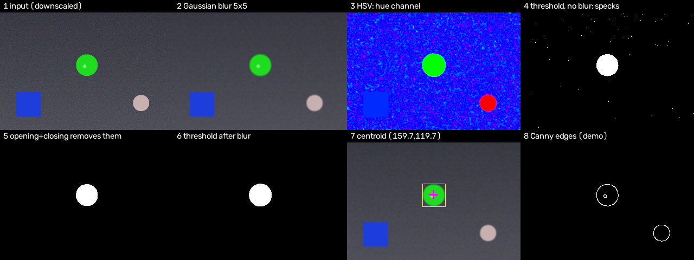
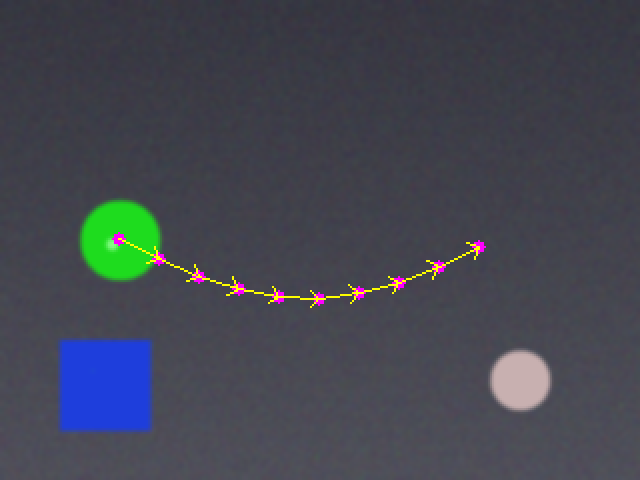
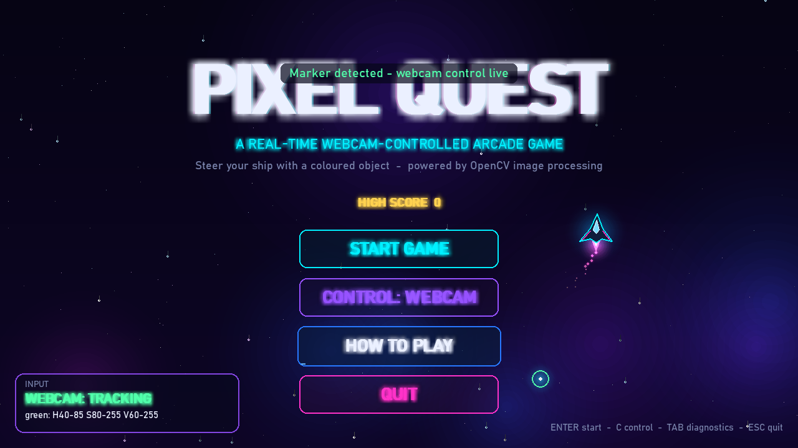
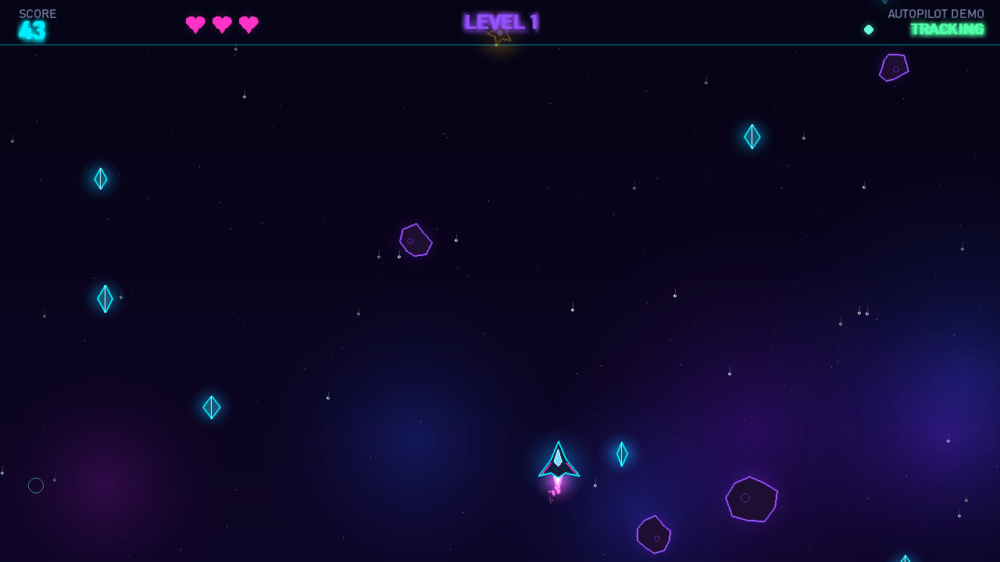
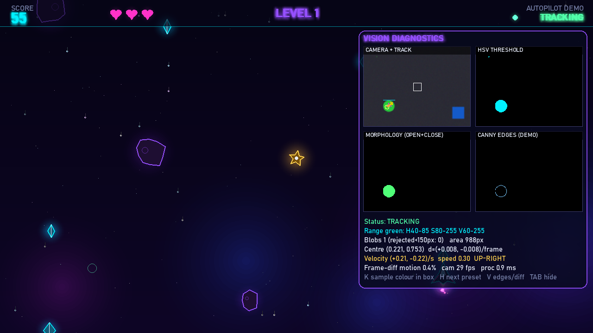
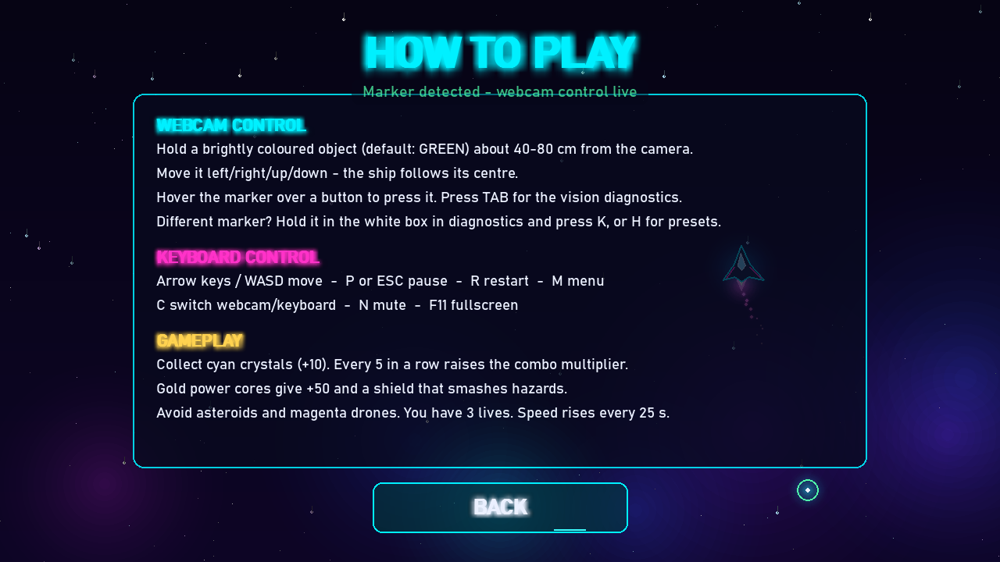

# Pixel Quest: A Real-Time Webcam-Controlled Arcade Game Using Image and Video Processing

**Project report** · Repository: https://github.com/ashmita-dev/PixelQuest · October 2026

## Abstract

Pixel Quest is a desktop arcade game in which the player steers a spaceship by moving a coloured object
in front of an ordinary webcam. Every captured frame passes through a classical image-processing pipeline:
downscaling and Gaussian smoothing, conversion from BGR to HSV colour space, threshold segmentation into a
binary mask, morphological opening and closing, contour extraction with a minimum-area filter, and centroid
computation from image moments. Across consecutive frames the centroid is smoothed with an exponential moving
average, and its frame-to-frame displacement gives a velocity estimate. The tracked position drives the ship in a
Pygame game with collectibles, hazards, scoring, lives and rising difficulty, and the keyboard remains a fallback
control. A toggleable diagnostics view shows each processing stage live. The vision components are verified
by 65 automated tests that use synthetic frames and simulated camera failures. The report describes the design,
the underlying theory, the tests that were actually run, and the system's limitations.

## 1. Introduction

Computer-vision interfaces let people control software through natural movement, without touching a controller.
Many current systems rely on trained neural networks. However, a large class of interaction problems can be
solved with classical image processing, which is transparent, cheap to run and easy to explain. Coloured-marker tracking is one
of the simplest such techniques, and it exercises several core topics of an Image and Video Processing course
in a single, demonstrable application.

### 1.1 Problem statement

Build a responsive game that a player can control with a coloured object held in front of a webcam, using only
classical image and video processing. The game must stay usable when no camera is available, and must expose its
internal processing so that each technique can be demonstrated and explained.

### 1.2 Objectives

- Acquire live video frames from a webcam and handle missing or failing cameras gracefully.
- Segment a configurable marker colour using HSV thresholding and clean the mask with morphology.
- Locate the marker robustly (ignoring small noise) and smooth its position over time.
- Estimate frame-to-frame motion of the tracked object.
- Integrate the tracker into a polished, complete arcade game with a keyboard fallback.
- Provide live diagnostics, calibration tools, automated tests and honest documentation.

### 1.3 Motivation

A game gives immediate, visible feedback about the quality of segmentation and tracking. Noise appears as jitter,
lost detections appear as a stalled ship, and lag can be felt directly. This makes the effects of each processing step
easy to observe and to explain during a demonstration.

## 2. Tools and Technologies

| Tool | Version used | Purpose |
|---|---|---|
| Python | 3.11.9 | Implementation language |
| OpenCV (`opencv-python`) | 5.0.0 | Capture, colour conversion, thresholding, morphology, contours, Canny |
| NumPy | 2.4.6 | Array operations, synthetic data, procedural audio |
| Pygame | 2.6.1 (SDL 2.28.4) | Window, rendering, input, sound |
| pytest | 9.x | Automated tests |
| python-docx / Microsoft Word | – | Report generation and PDF export |
| Git / GitHub CLI | 2.52 / 2.102 | Version control and publishing |

All processing runs locally and offline. No paid APIs, cloud services or trained models are used.

## 3. System Architecture and Workflow

The program is split into presentation, game logic and vision layers:

- **`src/vision.py`**: pure processing functions, frame sources (webcam, video file, synthetic) and `VisionTracker`, which
  runs capture and processing on a background thread and publishes the latest result under a lock.
- **`src/session.py`**: game rules (spawning, collisions, scoring, lives, levels), independent of rendering, so they can be unit-tested.
- **`src/game.py`**: the application state machine (menu, help, play, pause, game over), input handling and rendering.
  It calls `VisionTracker.snapshot()` once per frame.
- **`src/player.py`, `src/entities.py`, `src/effects.py`, `src/ui.py`, `src/audio.py`**: ship, objects, particles and
  starfield, HUD and diagnostics, and generated sound.
- **`src/config.py`**: every tunable parameter.

Per-frame workflow:

1. The vision thread reads a frame, runs `process_frame`, updates the smoother and motion estimator, and stores a `TrackerState`.
2. The game loop (60 FPS) takes the latest state, maps the normalised centre to the play area and passes it to the ship as a target.
3. If any movement key is held, keyboard input overrides the webcam target. If the camera is unavailable, only the keyboard is used.
4. The session updates entities and collisions and returns events, which the presentation layer turns into particles, text and sound.

Decoupling capture from rendering means a slow or stalled camera never freezes the game. The game simply uses the most recent
position, or none.

## 4. Image Processing Theory and Algorithms

### 4.1 Digital video acquisition

A digital video is a sequence of frames I_t(x, y), each a sampled, quantised image, captured at a regular rate.
OpenCV's `VideoCapture` returns 8-bit BGR frames. On Windows the program tries the DirectShow, Media Foundation and default
back ends in turn and requests 640×480. Read failures are counted, and 30 consecutive failures mark the camera as failed.

### 4.2 Pre-processing and enhancement

The frame is mirrored, so the screen behaves like a mirror, and downscaled to 320×240 using area interpolation. This averages
groups of pixels, which both reduces noise and cuts the processing cost by a factor of four. A 5×5 Gaussian filter, a weighted
average with weights from a 2-D Gaussian, then suppresses sensor noise. Without it, many isolated pixels pass the colour test
(Figure 1, tile 4).

### 4.3 Colour space conversion

RGB/BGR mixes colour and brightness in every channel. HSV re-expresses a colour as hue H (the colour's angle on the colour wheel),
saturation S (its purity) and value V (its brightness) [6]. A marker under brighter or dimmer light keeps roughly the same hue and changes
mainly in V. A box in HSV space therefore describes "this colour under varied lighting" much better than a box in BGR. OpenCV stores
8-bit hue as 0–179 (degrees ÷ 2).

### 4.4 Threshold segmentation

Segmentation assigns each pixel to the marker or the background. The binary mask is

M(x, y) = 255 if lower ≤ HSV(x, y) ≤ upper (element-wise), else 0.

Red hues lie at both ends of the hue axis. When the configured lower hue exceeds the upper hue, the interval is treated as
wrapping, and two masks, [lower_h, 179] and [0, upper_h], are combined with a bitwise OR. Saturation and value lower bounds
reject grey, white and dark pixels.

### 4.5 Morphological processing

Mathematical morphology probes a binary image with a structuring element B [5]. Erosion keeps a pixel only if B fits entirely in
the foreground, and dilation marks every pixel where B touches the foreground. The project uses a 5×5 elliptical element:

- **Opening** (erosion then dilation, once) removes foreground features smaller than B, such as speckles, while restoring larger blobs to roughly their original shape.
- **Closing** (dilation then erosion, twice) fills holes and gaps smaller than B, such as specular highlights on a shiny marker.

### 4.6 Region extraction and centroid

External contours of the cleaned mask are found with OpenCV's implementation of Suzuki and Abe's border-following algorithm [3].
Contours with area below 150 px² (at 320×240) are discarded as noise, and the largest remaining one is taken as the marker. Its
centroid comes from the spatial image moments m_pq = Σ x^p y^q I(x, y) [7]:

x̄ = m10 / m00,  ȳ = m01 / m00.

The centroid is normalised to [0, 1] by the frame size, so it does not depend on the camera resolution.

### 4.7 Temporal smoothing

Raw centroids jitter by a pixel or two from frame to frame. An exponential moving average filters them:

p_t = α z_t + (1 − α) p_(t−1),  α = 0.35,

where z_t is the new measurement. A smaller α gives smoother but laggier motion. When the marker is lost, the last estimate is held for 8 frames
(status HOLDING) before tracking is declared lost (SEARCHING).

### 4.8 Motion estimation

The motion of the tracked object is estimated from the displacement of its smoothed centroid between consecutive frames:
d_t = p_t − p_(t−1) and v_t = d_t / Δt, followed by EMA smoothing (factor 0.5). Speed and a compass direction are derived from v.
This is object-level, displacement-based motion estimation. It is related to, but much simpler than, the block-matching and
optical-flow methods used in video coding and analysis [9], neither of which is implemented here. **The project does not compress video and contains no codec.**

As a separate whole-image temporal measure, the diagnostics compute frame differencing, |I_t − I_(t−1)| > 25 on grey levels, and
report the fraction of changed pixels.

### 4.9 Edge detection (demonstration)

The diagnostics can show a Canny edge map (hysteresis thresholds 60/150) of the grey frame [4]. It illustrates gradient-based
edge detection but is not used for control.

### 4.10 Calibration

The player can calibrate a new marker colour live (key K) from a 24×24 box at the frame centre. Because hue is an angle, its centre is
the circular mean of the samples, and its spread is the 90th percentile of circular distance plus a margin. The S and V lower bounds are the 10th
percentile minus a margin. A slider tool (`scripts/calibrate_hsv.py`) provides manual tuning. Both save to `hsv_config.json`.

## 5. Mapping to Course Topics

| Topic | Implementation | Status |
|---|---|---|
| Image Segmentation | HSV threshold mask, contours, area filter, centroid | Implemented |
| Fundamentals of Digital Video | Threaded sequential frame acquisition, frame sources, failure handling | Implemented |
| Motion Estimation | Centroid displacement velocity (+ frame differencing in diagnostics) | Implemented |
| Colour Image Processing | BGR→HSV, hue wrap-around, circular-mean calibration | Implemented |
| Morphological Processing | Opening + closing, elliptical 5×5 element | Implemented |
| Image Enhancement | Area downscaling and Gaussian smoothing | Implemented |
| Edge Detection | Canny in diagnostics | Demonstration only |
| Video compression, optical flow, block matching | – | Not implemented |

A detailed mapping with function references and tests is given in `docs/IVP_MAPPING.md`.

## 6. Game Design

The player flies upward through space. Cyan crystals give 10 points times a combo multiplier, which rises by one for every 5
consecutive crystals, up to ×5. Gold power cores give 50 points and a 6-second shield that destroys hazards on contact. Asteroids and,
from level 3, sine-weaving drones cost a life, and each hit is followed by 2 s of invulnerability. The level rises every 25 seconds, which increases object
speed and spawn rate. Visual polish includes a three-layer parallax starfield, additive glow sprites, particle bursts, screen shake,
animated buttons, glowing text, a countdown, level banners and procedurally synthesised sound effects. Menus can be operated by
mouse, keyboard or webcam: hovering the tracked marker over a button for 1.4 s presses it.

## 7. Testing Methodology and Results

### 7.1 Automated tests (executed)

The suite (`tests/`, run with `python -m pytest -q`) contains **65 tests, all passing**. They run headlessly (SDL dummy driver) and never open a webcam.

| Area | Examples | Input type |
|---|---|---|
| Segmentation | binary disc mask with area within 10 % of πr²; other hues rejected; red wrap at H=2 and 176; grey ignored | Synthetic frames |
| Morphology | opening removes all salt noise; closing fills a 4×4 hole | Synthetic masks |
| Detection | centroid within 1 px; largest blob chosen; small blobs rejected and counted | Synthetic frames / masks |
| Enhancement | Gaussian blur reduces noise standard deviation by over 40 % | Synthetic noise |
| Temporal | EMA reduces jitter; hold-then-lose behaviour; velocity and direction; frame difference | Synthetic sequences |
| Calibration | sampled range detects the sampled hue only; red sample wraps; JSON round-trip | Synthetic frames |
| Sample set | 15 saved images: centroid error < 3 px vs. ground truth; motion dx within ±0.005 | Saved synthetic images |
| Tracker & failures | no camera, closed camera, driver exception, repeated read failures, missing video file, live sample recalibration | Fake / synthetic sources |
| Game logic | scoring, combo, collisions, invulnerability, game over, shield smash, levels, spawning, bounds, keyboard override | Headless session |
| Application | headless start-up, menu→play→pause→menu, game over and restart, diagnostics toggle, webcam failure → keyboard | Headless Pygame |

On 60 frames of the `SyntheticSource` test video, the tracked centroid stayed within 0.01 (normalised) of the generated position.
These synthetic results show the code behaves as designed. They do **not** measure real-world tracking accuracy.

### 7.2 Headless runs of the full game (executed)

`main.py --frames N` runs the real game loop with a fixed time step and exits. This was run with keyboard mode and with the
synthetic camera, diagnostics on and the autopilot (900 frames). The screenshots in this report were produced by
`scripts/capture_screenshots.py` from the same code.

### 7.3 Webcam checks performed on the development laptop

- The webcam opened through OpenCV and returned 640×480 BGR frames.
- With **no marker in view**, 45 frames were processed with each preset to look for background false positives. Green produced
  detections in 17/45 frames (largest blob 1048 px²), blue in 37/45, yellow in 15/45, and red, orange and pink in 0/45. This one
  informal observation, in one room, motivates the advice to check diagnostics and choose a colour absent from the background.
- Pipeline time was about 1.2 ms per frame (320×240, diagnostics extras off).

### 7.4 Manual webcam gameplay test (performed by the project author)

The project author ran `.venv\Scripts\python main.py` on their Windows laptop with a physical green marker and reported:
the game launched, webcam tracking worked, the spaceship followed the green marker, and keyboard controls worked.
This was a qualitative check by a person, not an automated or quantitative measurement. No accuracy or latency figures were recorded.

Not covered by that report, and therefore not verified: the gesture (hover) menu, live K calibration, the TAB diagnostics on real
footage, the HOLDING/SEARCHING behaviour when the marker is hidden, camera unplug handling on real hardware, and the slider
calibrator window (`scripts/calibrate_hsv.py`).

## 8. Screenshots

The following are real renders of the application. The diagnostics panel is fed by the project's synthetic test video
(`--camera synthetic`), and gameplay is flown by the demo autopilot, so that the screenshots could be produced without a person at the camera.
They are **not** captures of the author's manual webcam test (§7.4).

## 9. Limitations

- **Lighting dependence:** low light reduces S and V below the thresholds. Coloured light and automatic white balance shift hue.
- **Background colours:** any region of the marker's colour is a candidate, and the largest wins. A larger same-coloured object
  defeats the tracker, as shown deliberately in sample `synthetic_blue_low.png`.
- **Skin tones** may match the red, orange or pink ranges.
- **Single object** with no identity tracking, occlusion reasoning or prediction. Fast motion can blur the marker.
- **Latency:** capture, smoothing (α = 0.35) and ship easing add a small lag. This has not been measured end to end.
- The diagnostics panel covers part of the play field while it is open.
- No accuracy figures on real footage are available.

## 10. Future Scope

- Adaptive thresholds, or back-projection of a hue histogram (CamShift) for more robust colour tracking.
- Kalman filtering to predict the position through brief occlusions and reduce lag.
- Dense optical flow (Farnebäck) or Lucas–Kanade features as an alternative motion estimate.
- Two-marker or two-player modes and gesture triggers (e.g. a fast flick to fire).
- A recorded, consented real-footage test set with hand-labelled centres, to measure accuracy quantitatively.

## 11. Conclusion

Pixel Quest shows that a short chain of classical operations (Gaussian smoothing, HSV thresholding, morphological opening and closing, contour
moments, exponential smoothing and displacement-based motion estimation) is enough to turn an ordinary webcam into a responsive game
controller. The game is complete and playable with either input method. Each processing stage can be inspected live and is backed by
automated tests on synthetic data. The project's documentation separates what is implemented, what is a demonstration and what was not done.

## References

1. G. Bradski, "The OpenCV Library," *Dr. Dobb's Journal of Software Tools*, 2000.
2. R. C. Gonzalez and R. E. Woods, *Digital Image Processing*, 4th ed. Pearson, 2018.
3. S. Suzuki and K. Abe, "Topological structural analysis of digitized binary images by border following," *Computer Vision, Graphics, and Image Processing*, vol. 30, no. 1, pp. 32–46, 1985.
4. J. Canny, "A computational approach to edge detection," *IEEE Trans. Pattern Analysis and Machine Intelligence*, vol. PAMI-8, no. 6, pp. 679–698, 1986.
5. J. Serra, *Image Analysis and Mathematical Morphology*. Academic Press, 1982.
6. A. R. Smith, "Color gamut transform pairs," *ACM SIGGRAPH Computer Graphics*, vol. 12, no. 3, pp. 12–19, 1978.
7. M.-K. Hu, "Visual pattern recognition by moment invariants," *IRE Trans. Information Theory*, vol. 8, no. 2, pp. 179–187, 1962.
8. OpenCV documentation, "Changing Colorspaces" and "Morphological Transformations" tutorials, https://docs.opencv.org/4.x/
9. A. M. Tekalp, *Digital Video Processing*, 2nd ed. Prentice Hall, 2015.
10. Pygame documentation, https://www.pygame.org/docs/
